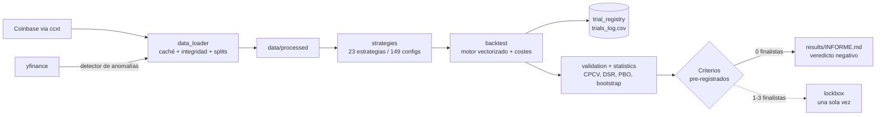

# crypto-edge-research — ¿hay ventaja real en cripto?

**Investigación cuantitativa pre-registrada que busca ventaja fuera de muestra en BTC, ETH, SOL y LTC — y concluye, con evidencia, que no la hay.**


> Software de investigación. No es asesoramiento financiero ni una herramienta para operar.

## Resumen

Búsqueda sistemática de estrategias con ventaja **fuera de muestra** sobre BTC, ETH,
SOL y LTC en marco diario. Long/flat, sin apalancamiento, con costes realistas.

El objetivo no es maximizar el Sharpe de un backtest. Es determinar si queda algo
después de descontar costes, sesgo de selección y suerte. **"No hay ventaja" es un
resultado esperado y aceptable**, y es el que el informe final reporta, sin adornos.

Lo que el proyecto demuestra es el proceso: criterios de aceptación escritos **antes**
del primer backtest, registro append-only de cada configuración evaluada, validación
cruzada combinatoria purgada, corrección por comparaciones múltiples, controles nulos
específicos y un lockbox que solo se abre si algo lo merece (no se abrió).

## Características principales

- **Pre-registro** — [`CRITERIOS_DE_ACEPTACION.md`](CRITERIOS_DE_ACEPTACION.md) fija 11
  criterios de validación (C1–C11) y 6 de lockbox (L1–L6) antes de ver ningún resultado;
  las enmiendas posteriores quedan versionadas en git y citadas en el informe.
- **Registro de intentos append-only** (`src/trial_registry.py` → `results/trials_log.csv`):
  todo lo que el código evalúa cuenta para el Deflated Sharpe.
- **CPCV purgado** (N=10, k=2 → 9 caminos), con purgado derivado del lookback y CPCV
  aplicado al *procedimiento de selección*, no a una configuración fija.
- **Estadística contra el overfitting**: Deflated Sharpe Ratio, PBO, IC 95 % del Sharpe
  por stationary block bootstrap, N_eff por participación de autovalores.
- **Controles nulos**: stationary block bootstrap (C9) y nulo de **exposición
  equiparada** por rotación circular de la senda de posiciones (C12).
- **Lockbox con centinela** (`lockbox/`): una sola ejecución, protegida por test
  (`tests/test_lockbox_guard.py`).
- **Higiene de datos**: Coinbase Exchange como serie de ejecución, yfinance como detector
  de anomalías (>2 %), convención UTC y tests de no-lookahead.
- **Validación fuera de cripto (E2.4)** con protocolo sellado en git antes de tocar las
  series externas ([`PROTOCOLO_E24.md`](PROTOCOLO_E24.md)).

## Arquitectura



## Metodología

| Elemento | Decisión |
|---|---|
| Activos | Optimización: BTC, ETH · Test cross-asset (100 % fuera de muestra): SOL, LTC |
| Datos | Coinbase Exchange = ejecución · yfinance = detector de anomalías (>2 %) |
| Marco | Diario, OHLCV, UTC |
| Posición | Long/flat (0 o 1). Sin apalancamiento ni cortos |
| Ejecución | Señal del cierre de `t` → **cierre de `t+1`** (`ret = s.shift(2) * r`) |
| Costes | 0,10 % comisión por lado + 0,05 % slippage por operación |
| TRAIN | 2015-2020 — optimización libre |
| VALIDATION | 2021-2023 — solo confirmar |
| LOCKBOX | 2024-hoy — **una sola ejecución, al final** |
| Benchmark | Buy & hold, mismos costes |
| Contra el overfitting | CPCV N=10/k=2 (**9 caminos**), purgado derivado del lookback, DSR, PBO, block bootstrap |
| Pre-registro | `CRITERIOS_DE_ACEPTACION.md` + Enmienda 1, ambos antes del primer backtest |
| Sharpe | siempre con IC 95 % por block bootstrap; IC que incluye 0 = NO CONCLUYENTE |

Las reglas metodológicas y sus umbrales están en
[`CRITERIOS_DE_ACEPTACION.md`](CRITERIOS_DE_ACEPTACION.md) y son innegociables. Las
amenazas a la validez se registran a medida que aparecen en
[`results/POR_QUE_PODRIA_ESTAR_EQUIVOCADO.md`](results/POR_QUE_PODRIA_ESTAR_EQUIVOCADO.md),
incluidas las que debilitan las conclusiones.

**Métricas del motor:** retorno total y anualizado · Sharpe · Sortino · máximo drawdown
y su duración · tasa de acierto · profit factor · número de operaciones · exposición
temporal. Todas se calculan también para el benchmark, en el mismo periodo y con los
mismos costes.

## Resultados

Fuente: [`results/INFORME.md`](results/INFORME.md).

> **No he encontrado ninguna estrategia con ventaja estadísticamente significativa.**

- **685 evaluaciones** registradas (678 configuraciones únicas) sobre un universo de
  **23 estrategias / 149 configuraciones** en 5 familias.
- **N_eff ≈ 3,7 (BTC) y 4,5 (ETH)**: las 149 configuraciones son unas 4 apuestas
  independientes.
- **Ninguna de las 3 finalistas superó VALIDATION**: los 12 IC 95 % (3 estrategias × 4
  activos) incluyen el cero; las 12 fallan C4 (11–26 operaciones frente a ≥ 50); ninguna
  supera el nulo de exposición equiparada (C12) en ningún activo.
- **DSR y PBO pasan en TRAIN pero no significan ventaja**: señales aleatorias con 55 % de
  exposición alcanzan Sharpe ≥ 0,70 el 90,5 % de las veces en el TRAIN de BTC por la
  deriva del activo.
- **Lockbox no abierto**: el pre-registro lo prohíbe con cero finalistas.
- **N_eff transversal**: 4 criptomonedas = **1,57** activos independientes (correlación
  media 0,72); oro, S&P 500, EURUSD y USDJPY = **3,75**. Añadir cripto no añade
  información.
- **E2.4 (fuera de cripto)**: sobre 13.709 sesiones pre-2015 de oro, S&P 500, EURUSD y
  USDJPY, las 19 configuraciones congeladas dan Sharpe conjunto positivo (mediana 0,46),
  15 de 19 con IC que excluye el cero, pero **solo 2 de 19** superan el control de
  exposición equiparada: la mayor parte del Sharpe es deriva del activo, no
  sincronización. La conclusión aguanta un rango de costes de 15×.
- **Forense (§6.1–6.3)**: la curtosis de 109 de la cartera conjunta es un solo día (19
  de octubre de 1987); la cartera tiene 1,66 mercados vivos por sesión de media y el
  S&P aporta el 74,5 % de la varianza; las 19 configuraciones externas son N_eff = 2,96.

## Stack

Python · NumPy · pandas · SciPy · ccxt (Coinbase) · yfinance · matplotlib · pytest

## Puesta en marcha

```bash
python3 -m venv .venv
.venv/bin/python -m pip install -r requirements.txt
.venv/bin/python -m pytest tests/ -q

# Fase 1: descarga, caché y validación de datos → results/data_quality.md
.venv/bin/python -m src.data_loader            # añadir --refresh para forzar descarga
```

Los datos crudos y procesados no se versionan (`data/` está en `.gitignore`); se
regeneran con `src.data_loader`. El script `notebooks/forense_e24.py` es diagnóstico
sobre los backtests externos ya ejecutados y espera su caché (`ext.pkl` + `frozen.json`)
como argumento.

## Estructura

```
CRITERIOS_DE_ACEPTACION.md  pre-registro de umbrales (antes del primer backtest)
PROTOCOLO_E24.md            protocolo sellado de la validación fuera de cripto
data/raw/                   OHLCV crudo, se descarga una vez
data/processed/             series limpias y validadas
src/config.py               constantes: costes, splits, semillas (única fuente de verdad)
src/data_loader.py          descarga, caché, integridad, splits
src/indicators.py           indicadores, todos causales
src/backtest.py             motor vectorizado + métricas
src/strategies.py           23 estrategias, cada una con su tesis económica declarada
src/validation.py           CPCV purgado, robustez, subperiodos, block bootstrap
src/statistics.py           block bootstrap, IC del Sharpe, Deflated Sharpe, PBO
src/trial_registry.py       registro append-only de configuraciones evaluadas
src/phase4.py               optimización en TRAIN por CPCV y selección
lockbox/                    evaluación final aislada — ver su README antes de tocarlo
notebooks/forense_e24.py    forense de la cartera conjunta de E2.4
results/                    INFORME.md, trials_log.csv, data_quality.md, registro de dudas
tests/                      motor, lookahead, costes, CPCV, estadística, guardia del lockbox
```

## Estado

- [x] **Fase 0** — Setup: estructura, entorno, reglas, guardia del lockbox
- [x] **Fase 1** — Datos: descarga, caché, validación de integridad
- [x] **Fase 2** — Motor + indicadores + CPCV purgado + estadística
- [x] **Fase 3** — 23 estrategias, 149 configuraciones, tesis obligatoria + datos externos
- [x] **Fase 4** — CPCV purgado, robustez, DSR y PBO: ninguna finalista sobrevive
- [x] **Fase 5** — Lockbox: **no abierto** (cero finalistas, según el pre-registro)
- [x] **Fase 6** — [`results/INFORME.md`](results/INFORME.md) con veredicto explícito (+ E2.4)

## Licencia

[MIT](LICENSE) © 2026 Gabriel Huertas
