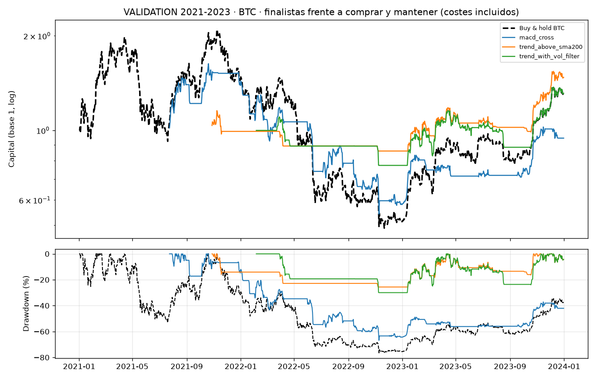
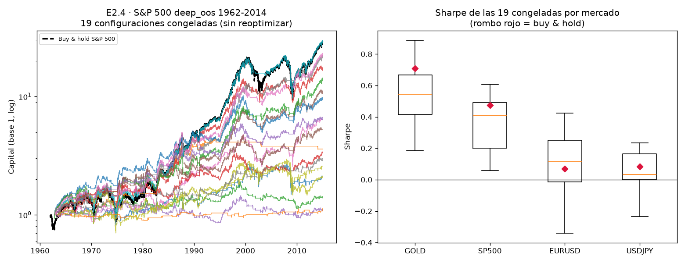

# Informe final — ¿hay ventaja real en criptomonedas?

Proyecto de investigación cuantitativa sobre BTC, ETH, SOL y LTC en marco diario,
long/flat, sin apalancamiento, con costes de 0,10 % de comisión por lado más
0,05 % de slippage por operación.

---

## Veredicto

> **No he encontrado ninguna estrategia con ventaja estadísticamente
> significativa.**

Ninguna de las tres finalistas superó la validación fuera de muestra. Fallaron por
cuatro vías independientes a la vez, no por un criterio apretado. **El lockbox
(2024 → hoy) no se ha abierto** y sigue sellado: el pre-registro lo prohíbe con
cero finalistas, y `lockbox/.lockbox_used` no existe.

### Por qué cripto no puede validar nada: el contraste de N_eff

El resultado más transferible del proyecto no es sobre ninguna estrategia, es sobre
el conjunto de datos. Número efectivo de activos independientes por participación
de autovalores, `(Σλ)²/Σλ²`, sobre la correlación de los retornos diarios:

| cartera | activos | correlación media | **N_eff transversal** |
|---|---:|---:|---:|
| BTC, ETH, SOL, LTC (solape común, 1.890 sesiones) | 4 | 0,72 | **1,57** |
| Oro, S&P 500, EURUSD, USDJPY (solape común, 2.121 sesiones) | 4 | 0,12 | **3,75** |

Cuatro criptomonedas son **una apuesta y media**; cuatro mercados externos son casi
cuatro. Ese es el motivo de fondo de que este proyecto no pueda concluir nada
positivo sobre cripto, y es más profundo que la historia corta: **añadir activos
de cripto no añade información**. Cuando una finalista falla en BTC, ETH, SOL y
LTC, eso está mucho más cerca de "ha fallado una vez" que de "ha fallado cuatro";
y al revés, si hubiera pasado en los cuatro tampoco serían cuatro confirmaciones.
Duplicar el universo de activos de cripto no arregla el problema de potencia: hay
que cambiar de eje —intradía, o fuentes de datos que no sean el precio— o aceptar
que la ventaja moderada no es validable con este material.

Matiz que sí sostienen los datos, y que es distinto de "no hay nada":

> El seguimiento de tendencia **sí** aparece fuera de cripto. Sobre 13.709 sesiones
> de oro, S&P 500, EURUSD y USDJPY anteriores a 2015 —datos que ningún parámetro de
> este proyecto ha visto— las 19 configuraciones congeladas dan Sharpe conjunto
> positivo, 15 de ellas con intervalo de confianza que excluye el cero. Pero solo
> **2 de 19** superan el control de exposición equiparada, así que la mayor parte
> de ese Sharpe se explica por estar largo en un activo con deriva, no por acertar
> el momento.

Con una advertencia de construcción que se detalla en §6.1-§6.3: esa cartera
«de cuatro mercados» tiene 1,66 mercados vivos por sesión de media y el S&P aporta
el 74,5 % de su varianza, y las 19 configuraciones son N_eff = 2,96 apuestas
independientes, no 19.

---

## 1. Cuántas configuraciones se han probado

Registro append-only, escrito en el momento de cada evaluación
(`results/trials_log.csv`, `src/trial_registry.py`).

| | |
|---|---:|
| Evaluaciones totales | **685** |
| Configuraciones únicas | 678 |
| Repeticiones | 7 |

| split | descartadas | exploración | conservadas |
|---|---:|---:|---:|
| `train` | 0 | 299 | 0 |
| `validation` | 298 | 0 | 12 |
| `deep_oos` (externos) | 0 | 0 | 76 |

Universo: **23 estrategias, 149 configuraciones**, en 5 familias — tendencia (9),
reversión (4), volatilidad (3), régimen (5), calendario (2). Cada una con su tesis
económica escrita como requisito de entrada; `turn_of_month` entró
deliberadamente **SIN TESIS**, como control.

**Número efectivo de intentos independientes** (participación de autovalores,
`(Σλ)²/Σλ²` sobre la correlación entre configuraciones):

| activo | N | N_eff | cociente |
|---|---:|---:|---:|
| BTC | 149 | **3,7** | 40× |
| ETH | 149 | **4,5** | 33× |

El universo explora unas **4 apuestas independientes**, no 149. Es un dato
incómodo en las dos direcciones: suaviza la corrección por comparaciones
múltiples, y a la vez dice que la búsqueda fue mucho más estrecha de lo que
aparenta.

---

## 2. Finalistas frente a comprar y mantener

Parámetros congelados en TRAIN (2015-2020), aplicados sin tocar nada a
VALIDATION (2021-2023). Sharpe con IC del 95 % por stationary block bootstrap.

| estrategia | activo | Sharpe | IC 95 % | ret. total | B&H Sharpe | ops | C12 |
|---|---|---:|---|---:|---:|---:|:--:|
| `macd_cross(12,50,18)` | BTC | 0,15 | [−1,27 · 1,61] | −5,5 % | 0,46 | 21 | no |
| | ETH | 0,58 | [−0,67 · 1,74] | 50,8 % | 0,85 | 19 | no |
| | SOL | 0,82 | [−0,84 · 2,29] | 92,0 % | 0,92 | 14 | no |
| | LTC | −0,03 | [−1,17 · 1,08] | −40,0 % | 0,24 | 22 | no |
| `trend_above_sma200(50,150)` | BTC | 0,81 | [−0,51 · 1,88] | 47,5 % | 0,46 | 12 | no |
| | ETH | 0,02 | [−1,04 · 1,18] | −12,4 % | 0,85 | 18 | no |
| | SOL | 1,25 | [−0,74 · 2,92] | 155,6 % | 0,92 | 15 | no |
| | LTC | −0,18 | [−1,33 · 0,82] | −32,1 % | 0,24 | 22 | no |
| `trend_with_vol_filter(100,60,0.9)` | BTC | 0,62 | [−1,10 · 2,05] | 31,3 % | 0,46 | 11 | no |
| | ETH | −0,51 | [−1,85 · 0,83] | −43,1 % | 0,85 | 18 | no |
| | SOL | 0,31 | [−1,67 · 2,21] | 3,7 % | 0,92 | 15 | no |
| | LTC | −0,24 | [−1,51 · 0,87] | −33,6 % | 0,24 | 26 | no |

**Los doce intervalos de confianza incluyen el cero.** Por la regla de
interpretación pre-registrada (Enmienda 1, E1.1) eso es NO CONCLUYENTE, nunca
"cumple".

Fallos, por criterio:

- **C1b** (Sharpe ≥ 0,70): fallan 9 de 12 en el punto estimado; las 3 que lo pasan
  tienen el cero dentro del intervalo.
- **C4** (≥ 50 operaciones): fallan **las doce**. Entre 11 y 26 operaciones. El
  pre-registro ya avisaba de que este criterio sesga contra la baja frecuencia;
  aquí ha mordido de lleno.
- **C8a** (Sharpe ≥ 0,40 en SOL y LTC): LTC sale negativo en las tres.
- **C12** (superar el nulo de exposición equiparada): **ninguna, en ningún activo**.

### Curvas de capital y drawdown

---

## 3. Deflated Sharpe y PBO

Sobre TRAIN, con la mejor configuración de cada activo y la matriz completa de
149 configuraciones:

| activo | PBO | p-valor PBO | C6 | DSR | p-valor DSR | C5 |
|---|---:|---:|:--:|---:|---:|:--:|
| BTC | 17,1 % | 0,000 | cumple | 1,000 | 0,000 | cumple |
| ETH | 17,7 % | 0,033 | cumple | 0,995 | 0,000 | cumple |

**C5 y C6 se cumplen y no significan lo que parece.** Ambos se calculan sobre
TRAIN, y en TRAIN el listón está roto por la deriva del activo: señales
**aleatorias** con 55 % de exposición y rotación realista alcanzan Sharpe ≥ 0,70
el **90,5 %** de las veces en el TRAIN de BTC (CAGR 134 %). Sobre la misma serie
sin deriva, el 0,8 %. Un DSR de 1,000 en ese contexto dice que la estrategia no es
un artefacto de haber probado muchas cosas; no dice que tenga ventaja.

CPCV sobre el **procedimiento de selección** (no sobre una configuración fija):
mediana de los 9 caminos = 1,57 en BTC y 1,67 en ETH, frente a un buy & hold de
1,51 y 1,35. Es decir: en TRAIN, seleccionar la mejor de la rejilla apenas bate a
no hacer nada.

---

## 4. Resultado sobre datos sintéticos

**C9 — stationary block bootstrap** de los retornos reales (bloque geométrico de
media 20 días, que conserva colas gruesas y agrupamiento de volatilidad), 400
caminos, VALIDATION de BTC:

| estrategia | Sharpe real | p95 del nulo | percentil | C9 |
|---|---:|---:|---:|:--:|
| `macd_cross` | 0,15 | 1,39 | 46,0 % | no |
| `trend_above_sma200` | 0,81 | 1,55 | 71,5 % | no |
| `trend_with_vol_filter` | 0,62 | 1,56 | 66,5 % | no |

Ninguna se distingue del ruido con la misma distribución marginal.

**C12 — nulo de exposición equiparada**, el control que más informó de todo el
proyecto. Rotaciones circulares de la propia senda de posiciones: conserva
exposición, rotación y duración de las operaciones exactamente, y solo destruye la
alineación con los retornos. Ninguna finalista lo supera en ningún activo.

---

## 5. Lockbox

**NO ABIERTO.** `lockbox/.lockbox_used` no existe; puede comprobarse en el
repositorio. El pre-registro (§2) dice: *"Si superan cero, el proyecto termina con
veredicto negativo y el lockbox no se abre"*. Superaron cero.

Abrirlo ahora no aportaría información y sí destruiría el único tramo de datos
limpio que queda para un proyecto futuro.

---

## 6. E2.4 — validación fuera de cripto

Motivo: el veredicto negativo era **ambiguo entre dos hipótesis**. Con 963
sesiones de lockbox el error estándar del Sharpe es 0,62 y una estrategia con
Sharpe verdadero de 0,40 se detecta ~16 % de las veces. Las series externas tienen
décadas.

Protocolo sellado en git **antes** de tocar ningún dato externo
(`PROTOCOLO_E24.md`): 19 configuraciones congeladas con parámetros exactos
procedentes solo del TRAIN de cripto, cero reoptimización, y regla de
interpretación escrita de antemano.

| mercado | sesiones `deep_oos` | periodo | B&H Sharpe |
|---|---:|---|---:|
| S&P 500 | 13.304 | 1962-2014 | 0,47 |
| USDJPY | 4.693 | 1996-2014 | 0,08 |
| Oro | 2.925 | 2000-2014 | 0,71 |
| EURUSD | 2.854 | 2003-2014 | 0,07 |

Resultado de las 19 congeladas sobre la cartera equiponderada de los cuatro
mercados (13.709 sesiones de calendario unido):

- **19 de 19 tienen Sharpe conjunto positivo.** Mediana 0,46.
- **15 de 19 tienen IC del 95 % que excluye el cero** (con los IC corregidos de
  §6.4; con los publicados originalmente, 14).
- **Solo 2 de 19 superan el nulo de exposición equiparada** (`ts_momentum(120)` y
  `breakout_volume_confirmed(55,50,1.5)`).
- Las tres finalistas de cripto dan 0,32 / 0,49 / 0,42 conjunto, y **ninguna**
  supera C12.

### Sensibilidad al coste

Sharpe conjunto, variando el coste por rotación de ×0,5 a ×7,5 sobre el base
(el ×7,5 lleva al S&P y a las divisas hasta el coste de cripto):

| multiplicador | ×0,5 | ×1,0 | ×2,0 | ×5,0 | ×7,5 |
|---|---:|---:|---:|---:|---:|
| coste S&P por rotación | 0,010 % | 0,020 % | 0,040 % | 0,100 % | 0,150 % |
| **mediana del Sharpe conjunto** | 0,48 | 0,46 | 0,43 | 0,35 | 0,28 |
| configuraciones con Sharpe > 0 | 18/18 | 18/18 | 18/18 | 18/18 | 18/18 |

**La conclusión no depende del coste.** Aguanta un rango de 15× y sigue siendo
positiva incluso cobrando comisiones de cripto en el S&P. Solo
`trend_above_sma200(20,150)` cruza el cero, y solo al multiplicador máximo.

### Lectura permitida

Según la regla escrita antes de ejecutarlo: **el fenómeno de la tendencia es real
y cripto no tiene longitud de muestra para detectarlo** (hipótesis H2). Esto **no**
autoriza a operarlo en cripto, y no reabre el veredicto. Con el matiz importante de
que ni siquiera fuera de cripto la mayoría de las configuraciones supera el control
de exposición equiparada: lo que sobrevive con más solidez es la deriva del activo,
no la sincronización.

### 6.1 Forense de la cartera conjunta: la curtosis de 109 es un solo día

El Sharpe conjunto se calcula sobre una serie con curtosis brutal —hasta 180, y
109 en `ts_momentum(120)`— y eso hay que explicarlo, no solo reportarlo. Como
referencia medida sobre estos mismos datos: el oro solo tiene curtosis 7,6, el S&P
solo 23,8 (11,7 si se quita octubre de 1987), y un buy & hold equiponderado de los
cuatro mercados en el tramo en que los cuatro cotizan, 10,9 una vez reparadas las
barras erróneas de divisas. Ningún efecto de calendario ni de agregación llega a
109.

**Curtosis bruta, recortada al 1 % por cola, y concentración** (conjunta de las
13.709 sesiones; `n_días` = cuántas observaciones acumulan la mitad del cuarto
momento):

| configuración | curtosis | recortada 1 % | días para el 50 % de m₄ | 3 peores días | sin octubre 1987 |
|---|---:|---:|---:|---:|---:|
| `bollinger_reversion` | 180,8 | 10,0 | 1 | 88,0 % | 33,5 |
| `zscore_reversion` | 153,2 | 9,0 | 1 | 87,5 % | 28,4 |
| `ema_cross` | 118,0 | 4,6 | 1 | 94,1 % | 9,9 |
| `rsi_reversion_in_uptrend` | 110,9 | 54,1 | 8 | 33,4 % | 110,7 |
| `ts_momentum` | **109,1** | **4,6** | **1** | **92,8 %** | **11,1** |
| `sma_cross` | 103,7 | 4,8 | 1 | 91,5 % | 10,3 |
| `ma_slope` | 91,2 | 4,7 | 1 | 89,4 % | 11,2 |
| *mediana de las 19* | 27,2 | 5,6 | 7 | 39,0 % | 14,5 |

La lectura es inequívoca. Siete de las 19 configuraciones tienen **un solo día que
explica la mitad del cuarto momento**, y en esas siete los tres peores días explican
entre el 83 % y el 94 %. Ese día es el **19 de octubre de 1987**, el S&P 500 con
−20,47 %. De las siete configuraciones con curtosis > 50, cuatro bajan de 15 sin más
que excluir octubre de 1987. Recortando el 1 % de cada cola, la curtosis mediana es
5,6 y la de `ts_momentum` cae a 4,6: exactamente lo que se espera de una cartera de
mercados con colas gruesas. No hay ninguna propiedad distribucional exótica; hay un
lunes negro.

**Por qué llega sin diluir: la cartera no está diversificada casi nunca.**
Mercados activos por sesión en el calendario unido:

| mercados activos | sesiones | % |
|---:|---:|---:|
| 1 | 9.201 | 67,1 % |
| 2 | 1.901 | 13,9 % |
| 3 | 655 | 4,8 % |
| 4 | 1.952 | 14,2 % |

Media: **1,66 mercados por sesión**. De las 9.201 sesiones con un único mercado,
8.930 son el S&P solo y 271 el USDJPY solo. Por eras: 1,00 mercados de media entre
1962 y 1997 (8.779 sesiones), 2,00 entre 1998 y 2004, 3,41 entre 2005 y 2014. La
primera sesión con los cuatro mercados vivos es el **22 de noviembre de 2004**.

Es decir: la columna «conjunta» es, durante dos tercios de su historia, el S&P 500
en solitario, y el 19 de octubre de 1987 entra en la cartera con peso 1. La
etiqueta «13.709 sesiones de cuatro mercados» sugiere una diversificación que solo
existe en el último 14 % de la muestra.

**Consecuencia sobre el error estándar: ninguna.** Y esto corrige una
interpretación anterior mía. El SE ingenuo es `sqrt(252/13.709) = 0,136`; el SE por
block bootstrap tiene mediana **1,04 veces** ese valor (rango 0,95-1,18), y
excluyendo octubre de 1987 la mediana es 1,04 igualmente. La fórmula de Lo (2002)
dice por qué: el término de curtosis entra como `(γ₄−3)/4 · SR_d²`, y con un
Sharpe diario de 0,03-0,04 ese producto es despreciable. Incluso con γ₄ = 109, el
factor de corrección de Lo sobre el SE es **1,02**.

Es decir: **la curtosis de 109 no ensancha el intervalo del Sharpe**. Lo que sí lo
ensanchaba en la primera versión de la tabla era un fallo de anualización que se
detalla en §6.4. El bootstrap sigue siendo la elección correcta —no exige estimar
un γ₄ que aquí lo fija una sola observación— pero coincide con la regla de bolsillo,
y la conclusión honesta es que aquí no había nada que corregir.

**Excepción que no es de colas:** `rsi_reversion_in_uptrend` mantiene curtosis 54
tras el recorte y no cambia al quitar 1987. Su mecanismo es otro: solo el **7,0 %**
de las sesiones tiene retorno no nulo (exposición media de las patas, 3,9 %). Una
serie casi siempre en cero tiene curtosis alta por definición. Su Sharpe conjunto
de 0,15 se apoya en poquísimas observaciones vivas y no debe leerse como el resto.

**Defecto de datos detectado de paso.** La curtosis bruta de las divisas (EURUSD
98,9; USDJPY 88,5) no es de mercado: son barras erróneas de yfinance. El
2008-12-08 el OHLC completo de EURUSD está en 1,49 con vecinos en 1,27, y el de
USDJPY en 110 con vecinos en 92; al día siguiente revierte. El patrón
pico-reversión aparece en 5 barras de EURUSD y 3 de USDJPY, todas de 2008.
**Impacto sobre las conclusiones: nulo** — excluyendo esas barras, el Sharpe
conjunto se mueve como máximo 0,006 (mediana 0,0006), porque las divisas pesan el
11 % de la varianza. Queda registrado en `results/data_quality.md`.

### 6.2 La columna conjunta está equiponderada por capital, no por riesgo

Reconocimiento explícito de una debilidad de construcción: la cartera conjunta es
la media simple de los mercados vivos cada día. Reparto real de la varianza
(covarianza de cada pata con la cartera, media de las 19 configuraciones):

| mercado | cuota de varianza, equiponderado por capital | ídem, ponderando por riesgo ex ante |
|---|---:|---:|
| S&P 500 | **74,5 %** | 87,8 % |
| Oro | 14,2 % | 3,8 % |
| USDJPY | 7,3 % | 6,3 % |
| EURUSD | 4,0 % | 2,1 % |

Con un N_eff transversal de 3,75 entre los cuatro mercados, la ponderación por
riesgo sería la construcción natural: es la que convierte cuatro apuestas casi
independientes en cuatro contribuciones comparables. **E2.4 no se rehace**, porque
estaba pre-declarada en `PROTOCOLO_E24.md` y cambiar la construcción después de ver
los resultados es exactamente lo que el pre-registro existe para impedir.

Pero hay un matiz que conviene decir ahora, porque cambia la lección: **ponderar
por riesgo no habría arreglado nada**. Aplicando pesos inversos a la volatilidad
de 252 días rezagada un día, la cuota del S&P **sube** al 87,8 % y los Sharpes
conjuntos se mueven menos de 0,03 (todos ligeramente a la baja). El motivo es el de
§6.1: durante el 67 % de las sesiones el S&P es el único mercado vivo, y ningún
esquema de pesos diversifica lo que no está ahí. El problema no es la ponderación,
es el calendario.

### 6.3 N_eff de las 19 configuraciones externas, medido y no prestado

En la primera redacción, el N_eff de las 19 configuraciones externas se tomó
prestado del 3,7 medido sobre las 149 configuraciones de cripto. Eso era un
préstamo, no una medición, y con mercados externos casi independientes la
expectativa razonable era que el N_eff de las 19 fuera **mayor**. Medido
directamente sobre la correlación de las 19 series conjuntas:

| muestra | sesiones | **N_eff de las 19** |
|---|---:|---:|
| calendario unido completo | 13.709 | **2,96** |
| solo sesiones con los 4 mercados vivos | 1.952 | 2,95 |
| 1998 en adelante | 4.930 | 3,32 |
| las 76 patas individuales (19 × 4 mercados) | 13.709 | 12,10 |
| N_eff de las 19 dentro de cada mercado | — | 2,7 (oro) a 3,5 (EURUSD) |

Autovalores de la matriz de correlación de las 19: el primero explica el **55,5 %**
de la varianza y los dos primeros el 69,7 %; la correlación media fuera de la
diagonal es 0,48.

**La expectativa era errónea y el dato va en la dirección contraria: 2,96, por
debajo del 3,7 prestado.** Los mercados externos son casi independientes entre sí,
pero eso no hace independientes a las 19 configuraciones: se aplican *todas a los
mismos cuatro mercados*, y lo que domina la correlación entre ellas es el factor
común de estar largas o planas a la vez en el mismo S&P. La diversificación
transversal no compra diversificación de configuraciones.

**Las dos lecturas del 2 de 19, sin elegir entre ellas.** Bajo la nula de que
ninguna configuración tiene sincronización, si cada prueba supera el control de
exposición equiparada un 5 % de las veces por azar:

| denominador | P(≥ 2 éxitos por azar) |
|---|---:|
| 19 pruebas tratadas como independientes | **24,6 %** |
| N_eff = 3 (medido arriba) | **0,7 %** |

La primera dice que 2 de 19 es lo que se espera del ruido; la segunda, que no lo
es. Ambas se reportan porque la elección del denominador **no es neutral y no la
puedo hacer después de ver el resultado**: N_eff mide correlación entre las series
de retornos, no entre los estadísticos del contraste, y usarlo como número de
pruebas independientes es una aproximación, no una identidad. Lo que sí es
defendible sin ambigüedad: 19 pruebas son bastante menos de 19 apuestas, así que la
corrección por comparaciones múltiples es más severa, no más laxa. Y las dos que superan el nulo de exposición equiparada
—`ts_momentum(120)` y `breakout_volume_confirmed(55,50,1.5)`— correlacionan **0,61**
entre sí: están más cerca de un éxito que de dos. La conclusión de §6 no cambia,
pero se apoya en menos evidencia efectiva de lo que sugiere el denominador 19.

### 6.4 Corrección: los IC de E2.4 estaban anualizados a 365 días

Encontrado al hacer la forense de §6.1. En la primera ejecución de E2.4 el Sharpe
puntual se anualizó con 252 sesiones (`config.EXTERNAL_TRADING_DAYS_PER_YEAR`,
correcto para mercados que no cotizan 24/7) pero el intervalo de confianza y el SE
analítico salieron con 365 (`config.TRADING_DAYS_PER_YEAR`, el de cripto). Punto e
intervalo no estaban en la misma escala: los IC publicados eran un **20 % más
anchos** de lo que corresponde, `sqrt(365/252) = 1,204`.

El error es **conservador** —intervalos más anchos, menos criterios superados— así
que corregirlo no rescata nada, pero cambia dos cifras del informe:

| | publicado (mezcla 252/365) | corregido (252) |
|---|---|---|
| SE mediano del Sharpe conjunto | 0,17 | 0,141 |
| IC del 95 % que excluyen el cero | 14 de 19 | **15 de 19** |
| Sharpes puntuales | sin cambio | sin cambio |
| Nulo de exposición equiparada (2 de 19) | sin cambio | sin cambio |

(La primera versión de este informe decía «13 de 19» sobre los intervalos a 365:
el recuento correcto de esos mismos intervalos es 14. Dos errores distintos, uno de
anualización y otro de conteo.)

La única que cambia de lado al corregir la escala es `macd_cross(12,50,18)`, de
[−0,01, 0,72] a [0,03, 0,58]. **No supera el nulo de exposición equiparada**
(percentil 20,5 %), que es el control que decide, así que la conclusión de §6 no se
mueve: sigue siendo 2 de 19, y sigue siendo la deriva del activo lo que explica la
mayor parte del Sharpe conjunto.

Los IC corregidos, para las 19: `results/e24_forense.csv`. El script que reproduce
toda esta sección es `notebooks/forense_e24.py`.

---

## 7. Por qué esto podría estar equivocado

Los argumentos más fuertes **en contra de mis propias conclusiones**. Registro
completo en `POR_QUE_PODRIA_ESTAR_EQUIVOCADO.md` (D1-D8).

### 7.1 El proyecto puede estar diciendo "no" por falta de potencia, no por falta de ventaja

Es la objeción más seria. Con `SE(Sharpe) ≈ sqrt(365/T)`, VALIDATION tiene SE de
0,58. Una estrategia con Sharpe verdadero de **0,70** —que sería excelente— se
detecta solo la mitad de las veces. Los doce intervalos de confianza incluyen el
cero, pero **también incluyen valores de 1,5 y 2,0**. Este proyecto no ha
demostrado que no haya ventaja: ha demostrado que **con estos datos no se puede
distinguir de cero**, que es una afirmación mucho más débil.

### 7.2 C4 puede haber matado a las supervivientes legítimas

Exigir ≥ 50 operaciones en 3 años obliga a más de una operación cada tres semanas.
El seguimiento de tendencia lento —la familia con **mejor** evidencia documentada
fuera de muestra, y la que E2.4 confirma— opera mucho menos que eso. El criterio
estaba pre-registrado y no se ha tocado, pero es posible que haya descartado justo
lo que funciona. Las doce finalistas fallaron C4.

### 7.3 El seguimiento de tendencia lento ni siquiera era evaluable

Con lookback 200 y calentamiento 400, el purgado del CPCV se come el 42,2 % de
TRAIN y la configuración queda **inviable**. La familia con mejor respaldo previo
está estructuralmente excluida del análisis en cripto por longitud de datos. Lo
que quedó evaluable es el conjunto complementario: horizontes cortos, evidencia
previa más débil, mayor sensibilidad a costes.

### 7.4 N_eff = 3,7 significa que apenas se buscó

149 configuraciones que son ~4 apuestas independientes. Un universo con familias
de verdad distintas —cross-sectional entre activos, datos on-chain,
microestructura, financiación de perpetuos— podría encontrar algo que este
universo no puede ver. "No hay ventaja" aquí significa "no hay ventaja en estas
cuatro apuestas".

### 7.5 Los cuatro activos son uno

D4: BTC, ETH, SOL y LTC comparten factor de mercado, con correlación media de
0,72 y **N_eff transversal de 1,57** frente a 3,75 de los cuatro mercados externos
(ver el contraste al principio del informe). "Falla en cuatro activos" está más
cerca de "falla en uno y medio" que de "falla en cuatro". La confirmación
cross-asset del resultado negativo es más débil de lo que sugiere la tabla.

### 7.6 Sesgo de supervivencia, y va en contra del veredicto negativo

D5: los cuatro activos existen hoy porque sobrevivieron. Eso **favorece** a las
estrategias de comprar y mantener y a las de reversión en el backtest. Que aun con
ese viento a favor no aparezca ventaja refuerza el veredicto — pero también
significa que el buy & hold contra el que se comparó está inflado, así que el
listón fue más alto de lo que habría sido en tiempo real.

### 7.7 El régimen 2015-2017 contamina TRAIN

D1: en 2017, Coinbase y yfinance discrepan más de un 2 % en el cierre en 118 días
solo en LTC. Si dos fuentes no se ponen de acuerdo en cuál era el precio, el
backtest de esa era depende de qué fuente elijas. Los parámetros de las finalistas
se ajustaron con esos datos dentro.

### 7.8 El coste podría estar mal en la otra dirección

0,15 % por rotación es razonable para un minorista en Coinbase, pero no incluye
impacto de mercado ni el diferencial real en momentos de estrés, que es
precisamente cuando estas estrategias operan. El coste realista podría ser peor,
lo que empeoraría el resultado, no lo mejoraría.

### 7.9 La evidencia externa descansa en el S&P 500, no en cuatro mercados

Es la objeción más fuerte contra la parte *positiva* del informe. La conclusión de
que «el seguimiento de tendencia sí aparece fuera de cripto» sale de una cartera
que es el S&P en solitario el 65 % de las sesiones y donde el S&P aporta el 74,5 %
de la varianza incluso cuando hay más mercados vivos (§6.1, §6.2). Con
N_eff = 2,96 entre las 19 configuraciones (§6.3), la evidencia externa está más
cerca de «la tendencia aparece en el índice bursátil estadounidense de 1962 a 2014»
que de «aparece en cuatro mercados independientes». Sigue siendo un régimen mucho
más largo e independiente que cripto —y por eso E2.4 valía la pena—, pero la
independencia entre mercados que justificaba la potencia de ~99 % del protocolo
solo se materializa en el último 14 % de la muestra.

### 7.10 Errores míos que sí ocurrieron durante el proyecto

Para calibrar cuánta confianza merece el resto:

- Reporté un PBO del 36 % sobre ruido como si fuera un sesgo del estimador. Era
  **una sola matriz**: el estimador está centrado en 0,50 y su desviación típica
  bajo la nula es 0,20.
- Dije que 7 estrategias disparaban validación externa. Eran **18**.
- Un test de causalidad mío daba por bueno un canal de Donchian sin `shift(1)`,
  porque el sesgo de misma vela no es una violación de causalidad. Hizo falta un
  test de especificación aparte.
- La tolerancia del test de perturbación estuvo en 1e-6 cuando la cota derivada es
  1,3e-11: nueve órdenes de magnitud donde se podía esconder una dependencia real.
- Reporté una curtosis de 109 en la serie conjunta de E2.4 sin explicarla. Era el
  19 de octubre de 1987 (§6.1): un solo día, con la cartera compuesta por el S&P en
  solitario. Recortada al 1 %, la curtosis es 4,6.
- Usé el N_eff de 3,7 medido sobre las 149 configuraciones de cripto para hablar de
  las 19 externas, sin medirlo. Medido, es 2,96 (§6.3), y mi expectativa de que
  fuera mayor que 4 también era errónea.
- Construí la cartera conjunta equiponderada por capital y describí sus 13.709
  sesiones como si fueran de cuatro mercados. Son 1,66 mercados por sesión de
  media.
- Publiqué los IC de E2.4 anualizados a 365 días junto a Sharpes anualizados a 252
  (§6.4): intervalos un 20 % más anchos de lo debido, y un «13 de 19» que sobre esos
  mismos intervalos era 14.
- Atribuí el ensanchamiento del SE a la curtosis. No era la curtosis —su efecto
  sobre el SE del Sharpe aquí es del 2 %—, era el fallo de anualización.

Los cuatro se detectaron y corrigieron, tres de ellos a instancias del revisor. Es
razonable suponer que quedan errores del mismo tipo sin detectar.

---

## 8. Qué haría falta para cambiar el veredicto

- Un universo con familias **de verdad** independientes (N_eff alto), no 149
  variaciones de la misma idea.
- Datos que cripto sí tiene y aquí no se usaron: financiación de perpetuos,
  profundidad de libro, flujos on-chain. Ahí puede haber primas estructurales sin
  equivalente en mercados tradicionales.
- Marco temporal intradiario, donde el número de observaciones cuasi-independientes
  es órdenes de magnitud mayor y el problema de D2 se atenúa.
- Aceptar de antemano que con 10 años de historia diaria y cuatro activos
  correlacionados, **la potencia estadística disponible no permite validar una
  ventaja moderada**. Ese es el resultado estructural del proyecto.

### Lecciones de construcción para una v2

Salen de la forense de §6 y son restricciones de diseño, no de resultado:

1. **Ponderar las carteras multi-mercado por riesgo, no por capital**, y declararlo
   en el pre-registro. Aquí no habría cambiado el número (§6.2), pero solo porque
   el calendario ya estaba roto; con mercados solapados sí lo cambia.
2. **Exigir calendario común, o reportar los mercados por separado.** Una media
   sobre «los mercados vivos ese día» convierte una cartera en un solo activo
   durante los tramos antiguos, y deja pasar un −20 % con peso 1. Lo honesto es
   restringir al solape (aquí, 2005-2014) y reportar el tramo largo mercado a
   mercado.
3. **Medir el N_eff de cada conjunto de pruebas, nunca importarlo de otro.** El
   préstamo de §6.3 falló por 0,74 y en la dirección contraria a la esperada.
4. **Reportar toda curtosis con su versión recortada y con la concentración del
   cuarto momento.** Un estadístico que depende de una observación tiene que
   declararlo en la misma línea en la que se reporta.
5. **Validar la integridad de las fuentes externas con el mismo rigor que las de
   cripto.** Las barras erróneas de divisas de 2008 (§6.1) eran inocuas aquí por
   pura suerte de ponderación.
6. **Retirar C4 (≥ 50 operaciones).** Era un proxy tosco de la precisión de la
   estimación y es **redundante con E1.1**: el IC del Sharpe por bootstrap mide lo
   mismo —cuánta información hay— sin penalizar por construcción a la baja
   frecuencia, que es justo donde está la familia con mejor evidencia previa
   (§7.2, §7.3). Se mantuvo aquí porque estaba pre-registrado; en un rediseño
   desaparece.
7. **Anualizar en un solo sitio.** El fallo de §6.4 fue posible porque el punto y el
   intervalo leían la constante por separado; ahora `sharpe_confidence_interval`
   toma un `periods` compartido y hay un test de regresión que lo fija.

---

*Todo lo anterior es reproducible: `.venv/bin/python -m pytest tests/ -q`
(699 tests), `results/trials_log.csv` (685 evaluaciones registradas),
la forense de E2.4 en `notebooks/forense_e24.py` y `results/e24_forense.csv`,
y el historial de git, donde el pre-registro y sus tres enmiendas son anteriores
al primer trial.*
